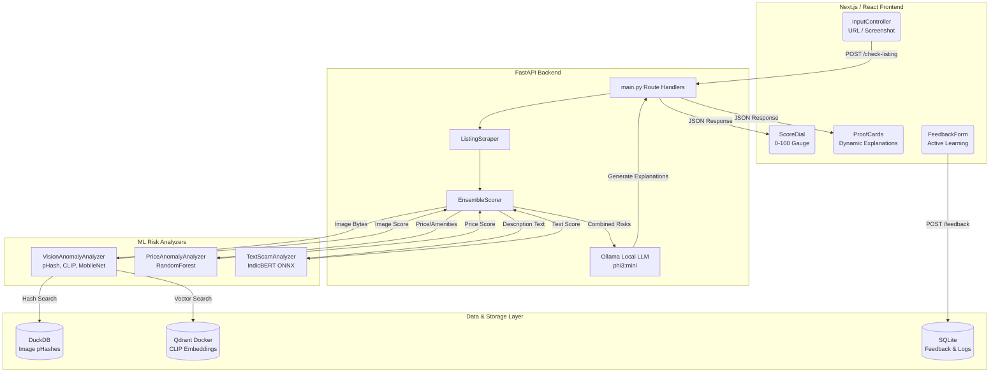
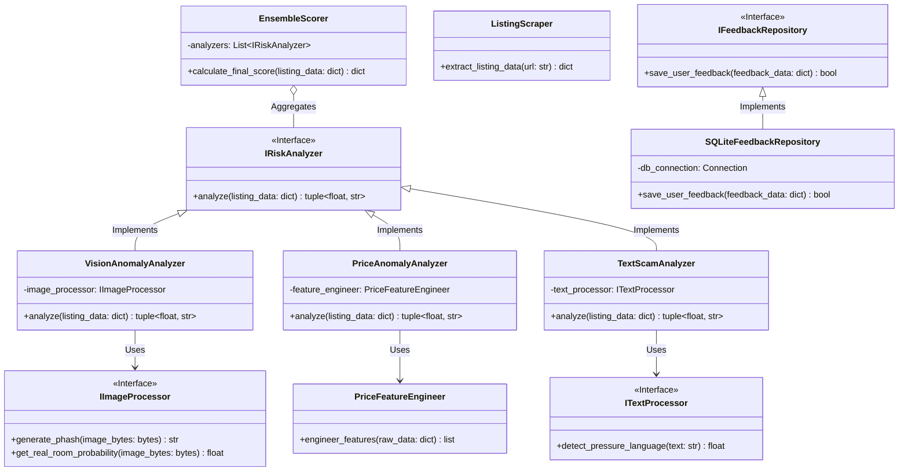

# RentRakshak - Module 1: UML & Architecture Diagrams

This document contains text-based UML and architecture diagrams for the RentRakshak Module 1 (Pre-Visit Guard) project, adhering to the SOLID principles outlined in the Low-Level Design (LLD).

## 1. System Architecture (Component Diagram)
This diagram illustrates the flow of data from the Next.js frontend through the FastAPI backend, the ML analyzers, and finally to the local data stores.

## 2. SOLID Class Diagram
This class diagram highlights the core Object-Oriented structure of the backend. It demonstrates how interfaces (`IRiskAnalyzer`, `IImageProcessor`) are used to decouple dependencies, fulfilling the Open/Closed and Dependency Inversion principles.

